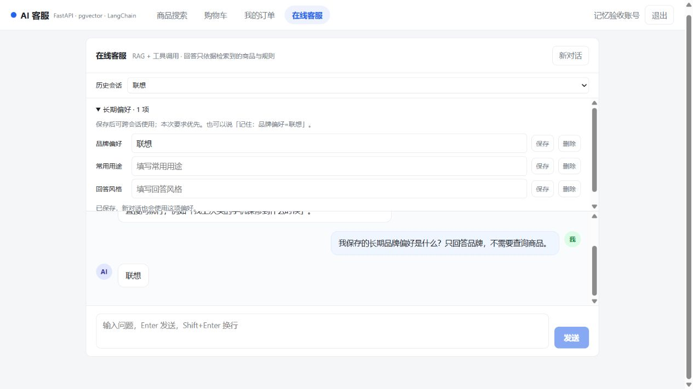
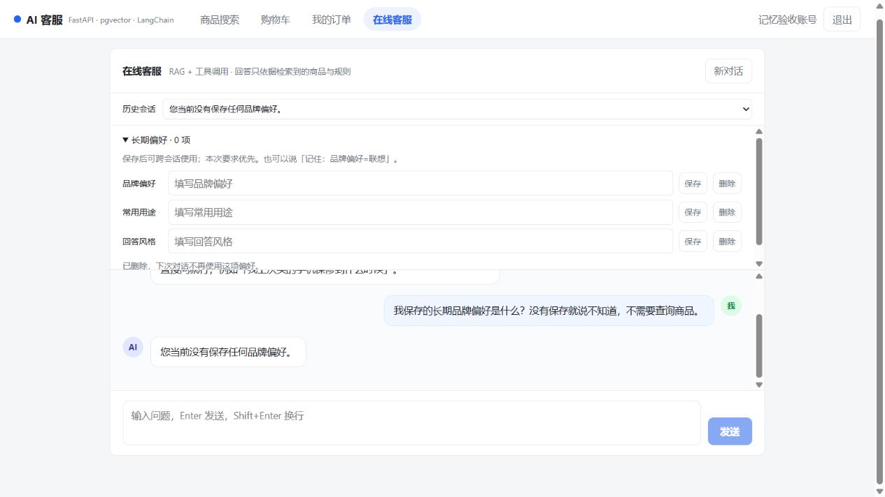

# 上下文管理与长期记忆交付说明

## 使用

开发页面：http://127.0.0.1:5274。登录后进入在线客服，展开“长期偏好”，可以查看、保存、修改和删除品牌偏好、常用用途、回答风格。

聊天也支持明确的保存与删除请求，例如：

- `请记住我喜欢联想`
- `我一直偏好ThinkPad`
- `我以后偏好苹果`
- `记住：常用用途=出差办公`
- `记住：回答风格=简洁`
- `忘记我的品牌偏好`

上述偏好绑定登录账号，新建会话和服务重启后仍可读取。游客不保存跨会话偏好；原有游客会话认领机制保留，认领不会自动扫描旧历史提取偏好。

仅提取本次用户明确表达的稳定偏好，不回扫历史，不使用模型回答猜测用户事实。普通的“我喜欢联想”、一次购买预算和疑问句不会自动保存；不在支持语法中的偏好，可直接在面板中保存。当前没有通用的任意事实记忆或向量记忆检索。

本次要求优先于长期偏好，当前长期偏好优先于历史中的旧偏好。价格、库存、订单状态继续由工具查询。删除后清空记忆值，保留撤销标记，告知模型不要从旧对话恢复该偏好；用户原始聊天记录不会因删除偏好被删除。

## 上下文修复

- 摘要检查进度与摘要覆盖水位分开，短会话检查后等待新消息，失败按检查时间公平重试。
- 单次摘要字数上限按完整问答轮累计，最后一轮允许软超限。
- 保留区由真正最新的窗口计算，旧前缀分批摘要，避免最早 4000 条被误当作最新保留区。
- 回答前检测摘要与窗口之间的缺口，立即补摘要，不等待 1500 字回滞或 300 秒调度周期。
- 摘要为空、调用失败或达到请求内批次上限时，保留原文和已完成进度，提示用户重试，不用缺失上下文继续生成回答。
- 同一会话通过自动续期的 Redis 租约避免并发问答交错；忙碌请求返回 SSE error，租约失效会中止本轮。
- 服务端实际记录 summary_chars、memory_chars 和 history_gap。
- 前端增加最近 20 个历史会话的选择入口，并阻止过期页面请求覆盖新账号/新会话的界面状态。

摘要是有损压缩，能保留什么仍取决于模型。原文仍在数据库；本轮没有增加摘要版本自动重建任务。极端巨大单轮若超过扫描边界，需要单独处理，不能声称所有历史形状都已覆盖。

## 接口与数据

- `GET /api/v1/chat/memories`：读取当前账号的有效偏好。
- `PUT /api/v1/chat/memories/{key}`：保存或纠正，JSON 为 `{"value":"联想"}`。
- `DELETE /api/v1/chat/memories/{key}`：撤销偏好，重复调用仍成功。
- key 仅支持 brand_preference、usual_use、answer_style；value 为 1～120 字的单行文本。
- 三个接口均要求登录，只使用 JWT 对应的 user_id，不接受目标用户 ID。
- `user_memories` 按 `(user_id, key)` 唯一，记录来源、更新时间、修订次数和删除标记。
- 迁移版本 `f6a7memory01`，父版本 `e5f6sessidx01`。新增摘要检查列、记忆表和索引，保留既有消息与订单。

## 配置

- `CHAT_SUMMARY_ENABLED`：关闭时不进行请求内摘要；遇到历史缺口提示重试，不静默截断。
- `CHAT_SUMMARY_REQUEST_MAX_PASSES=8`：一次回答最多补 8 批摘要，超过后保留进度供重试。
- 原有后台回滞、周期、批次大小继续使用。

长会话窗口再次溢出时会补摘要，可能连续多轮额外产生模型调用和等待时间。稳定偏好提取采用确定性规则，不额外调用模型。

## 验证

测试使用独立的 PostgreSQL 数据副本 shopping_context_test_20261008 和 Redis 14 号数据库；没有在正常业务库跑会修改商品库存的测试。

覆盖：10 个短会话后的长会话调度、默认上限半轮切分、超短消息触发条数保险丝、摘要失败重试、扫描上限、请求内摘要次数上限、跨会话读取/纠正/删除、用户隔离、接口校验、租约续期，以及实际日志字段。

另有真实 DeepSeek 验收：新会话读出联想 → 修改后读出苹果 → 删除后不再返回旧品牌；现有真实模型长会话摘要用例也通过。

当前已有的两个输出护栏误伤 xfail 属于独立缺陷，本轮没有修改护栏语义。

最终开启真实模型的完整回归：134 passed、2 xfailed（64.64 秒），没有跳过用例。此前不调用模型的回归为 128 passed、6 skipped、2 xfailed。前端生产构建通过。

四个旧模型用例已更新为接收服务端签发的会话 ID 和游客凭据，并断言 HTTP 状态，避免归属校验返回 410 时误以为已测试模型。域外拒答用例补充了实际出现的两种合理拒答表达，保留原有采样通过率及长度限制。

已在业务库执行 f6a7memory01 并重启 8200 后端，健康检查与新接口正常。浏览器使用临时账号验证保存 → 新会话读出联想 → 修改 → 删除 → 新会话回答“您当前没有保存任何品牌偏好”；验收账号及其消息已清理，原有 3520 条消息保留。

数据库备份：backend/backups/shopping_before_memory_20261008.dump（已加入忽略规则）。

页面验收截图：

